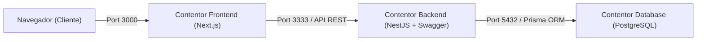

# 03. ARQUITETURA TÉCNICA E INFRAESTRUTURA: PHARMAWASTE

- **Projeto:** PharmaWaste
- **Tipo de Aplicação:** Web App B2B (SPA / SSR) + API RESTful
- **Data de Definição:** 2026-11-12

---

## 1. Stack Tecnológica Oficial

| Camada | Tecnologia | Justificação / Papel |
| :--- | :--- | :--- |
| **Frontend** | **Next.js (App Router)** | SSR/SSG veloz, SEO para landing page e SPA reativa para o dashboard. |
| **Linguagem (Front)** | **TypeScript** | Tipagem estrita e prevenção de erros em tempo de compilação. |
| **Estilos & UI** | **Tailwind CSS + Lucide Icons** | Design ágil, responsivo e componentes acessíveis e limpos. |
| **Autenticação** | **Better Auth** | Solução moderna e type-safe para Next.js/Node; sessões seguras, suporte nativo a Prisma e multi-tenancy/organizações. |
| **Backend** | **NestJS** | Framework modular empresarial, injeção de dependências robusta e escalável. |
| **Documentação API**| **Swagger / OpenAPI** | Documentação interativa e contratos de API automáticos via decorators NestJS. |
| **ORM & Migrations**| **Prisma** | Queries tipadas, migrations seguras e integração perfeita com TypeScript. |
| **Base de Dados** | **PostgreSQL (Docker)** | Fiabilidade relacional, suporte JSONB e transações ACID para dados farmacêuticos. |

---

## 2. Decisão Arquitetural de Contentorização (Docker)

### Recomendação Adotada: Contentores Separados via Docker Compose



### Porquê contentores 100% separados (e não tudo no mesmo container)?
1. **Escalabilidade Independente:** O backend (que processa parsing de ficheiros pesados de 15.000 linhas) pode precisar de mais recursos de CPU sem sobrecarregar o servidor web do Next.js.
2. **Deploys e Hot-Reload Independentes:** Alterações na interface não obrigam a reiniciar a API nem interrompem tarefas assíncronas do backend.
3. **Ambiente Limpo:** Cada serviço tem o seu próprio `Dockerfile` otimizado (multi-stage build para produção).

### Estrutura Monorepo Adotada:
```text
projects/pharmawaste/
├── apps/
│   ├── web/                     # Frontend Next.js (App Router, Tailwind, Better Auth Client)
│   └── api/                     # Backend NestJS (Prisma, Swagger, Better Auth Server)
├── docker-compose.yml           # Orquestração local (web, api, db)
└── README.md
```

### Estrutura de Orquestração (`docker-compose.yml`):
- Serviço `pharmawaste-db`: Imagem oficial `postgres:16-alpine` com volume persistente de dados.
- Serviço `pharmawaste-api`: NestJS app em Node 20 / 22.
- Serviço `pharmawaste-web`: Next.js app.

---

## 3. Mecanismo de Ingestão de Dados (O Core do MVP)

### Fluxo de Drag & Drop e Processamento:
1. **Dropzone Intuitiva (Frontend):**
   - Suporte a arrastar e largar ficheiros `.xlsx`, `.xls` e `.csv`.
   - Validação prévia de tamanho (< 25MB) e formato no cliente.
2. **Seleção Manual Alternativa:**
   - Botão clássico de pesquisa de ficheiros no explorador do Windows/Mac.
3. **Pipeline de Processamento (Backend NestJS):**
   - Endpoint: `POST /api/v1/inventory/upload`
   - Biblioteca de parsing: `xlsx` / `exceljs` ou `csv-parser` em stream.
   - Normalização de Colunas Farmacêuticas:
     - Código Nacional do Medicamento (CNP)
     - Designação / Nome Comercial
     - Número de Lote
     - Data de Validade (conversão de formatos variados: DD/MM/AAAA, MM/AA, AAAA-MM-DD)
     - Quantidade em Stock
     - Preço de Custo (PVP / PVPF)
4. **Cálculo de Risco de Desperdício:**
   - 🔴 **Crítico (< 60 dias):** Ação imediata de devolução a laboratório ou armazenista.
   - 🟡 **Alerta (60 a 90 dias):** Probabilidade de expiração sem venda com base no histórico.
   - 🟢 **Saudável (> 90 dias):** Stock seguro.
